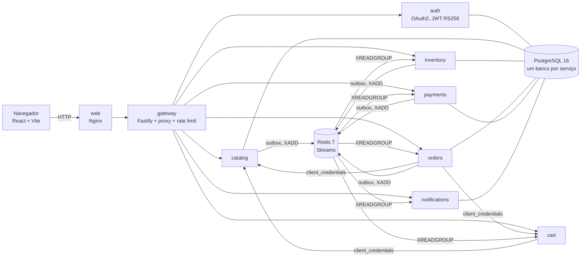

<p align="center">
  
</p>

<h1 align="center">Cesto<br><sub><sup><sup><sub>Copyright (©) 2026 Clara Portes</sub></sup></sup></sub></h1>

<p align="center">
  API de e-commerce em microsserviços: catálogo, estoque, carrinho, pedidos, pagamentos e notificações conversando por eventos, com login OAuth2, validação estrita em todas as entradas e uma loja web que consome a própria API.
</p>

<p align="center">
  TypeScript 5.9, Node.js 22, Fastify 5, Prisma 7, PostgreSQL 16, Redis 7 Streams, Zod 4, OAuth2 com PKCE, React 19 com Vite, Docker Compose e Vitest
</p>

<p align="center"></p>

Versão 1.1.0. Dois manuais em PDF acompanham o projeto:

- [`Manual-Cesto.pdf`](Manual-Cesto.pdf) (cópia em [`docs/`](docs/Manual-Cesto.pdf)): instalação, cada tela, arquitetura, OAuth2, contratos tipados, API, configuração, como estender o projeto, testes e solução de problemas.
- [`Banco-de-Dados-Cesto.pdf`](Banco-de-Dados-Cesto.pdf) (cópia em [`docs/`](docs/Banco-de-Dados-Cesto.pdf)): diagrama de cada banco, todas as tabelas com campos, tipos, chaves e índices, máquinas de estado, outbox, chaves do Redis e como preparar o PostgreSQL.

## O que é

O Cesto cobre o caminho inteiro de uma loja, dividido em oito serviços: gateway, autenticação, catálogo, estoque, carrinho, pedidos, pagamentos e notificações. Cada serviço tem o próprio processo e o próprio banco, e pode ser escalado sozinho.

- O pedido é uma saga. O checkout cria o pedido, o estoque reserva os itens, o pagamento cobra e o pedido é confirmado. Se faltar estoque ou o pagamento for recusado, as etapas anteriores são desfeitas e o estoque volta.
- Os eventos passam por Redis Streams com grupos de consumidores. Um outbox transacional garante que o evento só sai se o dado foi gravado; quem consome descarta entregas repetidas, tenta de novo quando falha e manda para a dead-letter depois de 5 tentativas.
- O login usa OAuth2: Authorization Code com PKCE para a interface, Client Credentials entre serviços, JWT RS256 com JWKS, refresh token com rotação e detecção de reuso, escopos por papel.
- Cada rota é um contrato Zod. O mesmo contrato valida a entrada no servidor, tipa o handler, gera o OpenAPI e alimenta o cliente HTTP tipado da interface.
- Erros de negócio (`NotFound`, `Conflict`, `InsufficientStock`, `InvalidTransition` e outros) viram respostas HTTP padronizadas, com código, mensagem, detalhes por campo e `requestId`.
- A loja web tem catálogo com busca, carrinho, checkout, acompanhamento do pedido etapa por etapa, notificações e painel administrativo de produtos, estoque e expedição.
- Cada um dos 16 produtos de demonstração tem uma ilustração própria em SVG (`apps/web/public/produtos/<slug>.svg`), gravada em `imageUrl` pelo seed. Um produto com `imageUrl` próprio mostra essa imagem; sem ela, a loja tenta a ilustração do slug e, se não houver, mostra um espaço neutro.
- Para operar: health checks, rate limit no gateway, logs estruturados, desligamento gracioso, migrações versionadas e Swagger em `/api/docs`.

## Ver rodando

Você só precisa do Docker com Docker Compose.

No Windows, dê dois cliques em `iniciar.cmd`. No Linux ou macOS:

```bash
./iniciar.sh
```

Na primeira vez o script cria o `.env` com uma senha aleatória para o banco e um segredo aleatório para os serviços, sobe os contêineres (PostgreSQL, Redis, os oito serviços e a interface) e abre http://localhost:8080.

| Endereço | O que é |
|---|---|
| http://localhost:8080 | Loja e painel administrativo |
| http://localhost:8080/api/docs | Documentação da API (Swagger) |
| http://localhost:8080/api/openapi.json | Especificação OpenAPI gerada dos contratos |
| http://localhost:8080/health | Saúde do gateway e de cada serviço |

### Contas de demonstração

As duas contas usam a senha `Cesto@2026` e existem para que qualquer pessoa consiga entrar logo depois de baixar o projeto. Os nomes, os produtos e o domínio `cesto.dev` são fictícios.

| Papel | E-mail | O que pode fazer |
|---|---|---|
| Administrador | `admin@cesto.dev` | Tudo, incluindo produtos, estoque e expedição de pedidos |
| Cliente | `cliente@cesto.dev` | Carrinho, pedidos e notificações |

Para provocar as falhas que a saga trata:

| Quero ver | Como fazer |
|---|---|
| Pagamento recusado | No checkout, escolha Cartão e marque "Simular cartão recusado" |
| Falta de estoque | Compre a Prensa francesa 600 ml, que começa zerada |
| Limite de valor | Feche um pedido acima de `PAYMENT_DECLINE_ABOVE_CENTS` (padrão R$ 5.000,00) |

<p align="center">
  
  
</p>

## Instalar

### Com Docker, sem o script

```bash
cp .env.example .env            # troque DB_PASSWORD e SERVICE_CLIENT_SECRET
docker compose up -d --build
docker compose up -d --scale inventory=3 --scale payments=2   # mais consumidores quando precisar
docker compose logs -f orders   # acompanhar a saga
```

### Em produção

Suba com `SEED_DEMO=false` num banco vazio. Os clientes OAuth2 continuam sendo criados. Cadastre sua conta pela tela de entrada e promova-a a administrador direto no banco `cesto_auth` (o comando está no manual, capítulo 2). Ajuste também `WEB_REDIRECT_URIS` e `CORS_ORIGINS` para o endereço público e coloque um proxy com HTTPS na frente da porta `APP_PORT`.

### Sem Docker, para desenvolver

Com Node.js 22, PostgreSQL 16 e Redis 7 instalados:

```bash
npm ci
cp .env.example .env                 # ajuste DB_USER, DB_PASSWORD e DB_HOST
psql -U postgres -f docker/postgres/init.sql
npm run generate                     # clientes Prisma de cada serviço
npm run build
npm run migrate                      # aplica as migrações nos seis bancos
npm run dev                          # sobe os oito serviços com recarga automática
npm run dev -w apps/web              # interface em http://localhost:5173
```

## Configuração

As principais variáveis do `.env` estão abaixo. A lista completa está no manual, capítulo 8.

| Variável | Padrão | O que faz |
|---|---|---|
| `APP_PORT` / `GATEWAY_PORT` | `8080` / `8000` | Portas da interface e da API |
| `DB_USER` / `DB_PASSWORD` | `cesto` / sem padrão | PostgreSQL. A senha é gerada pelos scripts; nunca publique a sua |
| `SERVICE_CLIENT_SECRET` | sem padrão | Segredo do cliente OAuth2 usado entre serviços |
| `ACCESS_TOKEN_TTL` / `REFRESH_TOKEN_TTL` | `900` / `2592000` | Validade dos tokens em segundos |
| `WEB_REDIRECT_URIS` | `http://localhost:8080/callback` | Endereços permitidos para o login da interface |
| `CORS_ORIGINS` | `http://localhost:8080` | Origens aceitas pelos serviços |
| `SEED_DEMO` | `true` | Contas, categorias, produtos e estoque de demonstração |
| `PAYMENT_DECLINE_ABOVE_CENTS` / `PAYMENT_DELAY_MS` | `500000` / `800` | Comportamento do pagamento simulado |
| `RATE_LIMIT_MAX` / `RATE_LIMIT_WINDOW` | `300` / `1 minute` | Limite de requisições por IP no gateway |
| `LOG_LEVEL` | `info` | Nível dos logs |

## Usar a API

O login da interface usa Authorization Code com PKCE. Scripts fazem o mesmo fluxo; o [`scripts/smoke.mjs`](scripts/smoke.mjs) é um exemplo completo.

```bash
# catálogo público
curl "http://localhost:8080/api/v1/catalog/products?q=café&sort=price_asc&pageSize=10"

# com o token do usuário
curl -H "Authorization: Bearer $TOKEN" -H "Content-Type: application/json" \
     -d '{"productId":"<id>","quantity":2}' http://localhost:8080/api/v1/cart/items

# fechar o pedido
curl -H "Authorization: Bearer $TOKEN" -H "Content-Type: application/json" \
     -d '{"paymentMethod":"pix","shippingAddress":{"recipient":"Ana","street":"Rua A","number":"10","district":"Centro","city":"Niterói","state":"RJ","postalCode":"24020-000"}}' \
     http://localhost:8080/api/v1/orders
```

Toda resposta segue o mesmo envelope:

```json
{ "ok": true, "data": { "id": "...", "status": "PENDING" } }
{ "ok": false, "error": { "code": "INSUFFICIENT_STOCK", "message": "...", "details": {}, "requestId": "..." } }
```

| Rota | O que faz |
|---|---|
| `POST /oauth/authorize`, `POST /oauth/token`, `POST /oauth/revoke`, `GET /oauth/jwks` | Login com PKCE, emissão e revogação de tokens, chaves públicas |
| `POST /api/v1/auth/register`, `GET /api/v1/auth/me` | Cadastro e usuário atual |
| `GET /api/v1/catalog/products`, `GET .../{id}` | Lista com busca, categoria, faixa de preço, ordenação e paginação |
| `POST/PATCH/DELETE /api/v1/catalog/products`, `POST /api/v1/catalog/categories` | Gestão do catálogo (`catalog:write`) |
| `GET /api/v1/inventory`, `PUT /api/v1/inventory/{id}` | Saldo por produto e ajuste (`inventory:write`) |
| `GET/DELETE /api/v1/cart`, `POST /api/v1/cart/items`, `PATCH .../{productId}` | Carrinho |
| `POST /api/v1/orders`, `GET /api/v1/orders`, `GET .../{id}`, `POST .../{id}/cancel` | Checkout, histórico e cancelamento |
| `PATCH /api/v1/orders/{id}/status` | Envio, entrega ou cancelamento pela loja (`orders:manage`) |
| `GET /api/v1/payments/orders/{orderId}` | Pagamentos e estornos do pedido |
| `GET /api/v1/notifications`, `/unread`, `POST .../{id}/read`, `/read-all` | Notificações |

<p align="center">
  
  
</p>

## Por dentro



| Serviço | Porta | Responsabilidade |
|---|---|---|
| `gateway` | 8000 | Porta única da API: roteamento, rate limit com Redis, `request-id`, OpenAPI e Swagger. Rotas `/internal` nunca saem daqui |
| `auth` | 4001 | Usuários, clientes OAuth2, códigos de autorização, tokens, chaves de assinatura e JWKS |
| `catalog` | 4002 | Produtos, categorias, busca, paginação e eventos de produto |
| `inventory` | 4003 | Saldo, reservas por pedido, baixa e devolução de estoque |
| `cart` | 4004 | Carrinho no Redis com preços sempre lidos do catálogo |
| `orders` | 4005 | Checkout, máquina de estados e orquestração da saga |
| `payments` | 4006 | Cobrança por um gateway plugável (simulado por padrão) e estorno |
| `notifications` | 4007 | Notificações geradas a partir dos eventos |
| `web` | 8080 | Loja e painel em React servidos pelo Nginx |

### Como um pedido é processado

1. `POST /api/v1/orders` lê o carrinho e os preços atuais com um token de serviço, grava o pedido como Reservando e, na mesma transação, o evento `order.placed` no outbox.
2. O `inventory` reserva todos os itens de uma vez (`available >= quantidade`, numa transação). Se algum faltar, publica `inventory.rejected` e o pedido é cancelado.
3. Com a reserva feita, o pedido passa a Aguardando pagamento e publica `payment.requested`. O `payments` cobra e responde `payment.approved` ou `payment.declined`.
4. Se o pagamento for aprovado, o pedido fica Confirmado e o estoque reservado vira baixa definitiva. Se for recusado, o pedido é cancelado e a reserva volta para o saldo.
5. O evento `order.placed` esvazia o carrinho, e cada etapa vira uma notificação para o cliente. Depois a loja marca o pedido como Enviado e Entregue.

<p align="center">
  
</p>

### Tipagem e validação

Os contratos ficam em [`packages/contracts`](packages/contracts) e são a única fonte da verdade:

```ts
export const api = {
  orders: {
    checkout: defineEndpoint({
      method: 'POST',
      path: '/api/v1/orders',
      auth: 'user',
      scopes: ['orders:write'],
      body: CheckoutBody,
      response: OrderDto,
      status: 202
    })
  }
};

route(app, api.orders.checkout, ({ principal, body }) => orders.checkout(principal.id, body));

const order = await request(api.orders.checkout, { body: { shippingAddress, paymentMethod: 'pix' } });
```

| Peça | O que entrega |
|---|---|
| `Dto<S>`, `CreateDto<T>`, `UpdateDto<T>`, `Paginated<T>`, `ApiResponse<T>`, `Result<T, E>` | DTOs genéricos usados por todos os serviços |
| `defineEndpoint` + `PathParams<'/orders/:id'>` | Parâmetros de rota extraídos do caminho em tempo de compilação |
| `EndpointRequest<E>` / `EndpointResponse<E>` | Requisição e resposta inferidas do contrato, no servidor e no cliente |
| `route(app, endpoint, handler)` | Valida params, query e body com Zod, checa token, papel e escopos e valida a saída |
| `callEndpoint` / `ServiceClient` | Cliente HTTP tipado, com token de serviço em cache para chamadas internas |
| `DomainError` e subclasses | Erros de negócio com código estável e status HTTP definido num só lugar |
| `eventSchemas` | Cada evento tem esquema próprio, validado ao publicar e ao consumir |

### Estrutura

```text
packages/contracts/   esquemas Zod, DTOs genéricos, contratos das rotas, eventos e cliente tipado
packages/core/        servidor Fastify, rotas tipadas, OAuth2 (verificação), erros de domínio, outbox, OpenAPI
packages/bus/         barramento de eventos em Redis Streams com novas tentativas e dead-letter
services/             gateway, auth, catalog, inventory, cart, orders, payments, notifications
  */prisma/           esquema e migrações de cada banco
apps/web/             loja e painel em React + Vite
docker/               Dockerfiles, Nginx e criação dos bancos
scripts/              desenvolvimento local, migrações, geração do Prisma e teste ponta a ponta
docs/                 manuais em PDF e imagens do README
.github/workflows/    CI
```

### Como estender

1. Nova rota: declare o contrato em `packages/contracts/src/api.ts` e registre com `route(app, api.x.y, handler)` no serviço. Validação, autorização, OpenAPI e tipos do cliente vêm juntos.
2. Novo evento: acrescente o esquema em `eventSchemas`, grave no outbox de quem publica e inscreva o handler com `bus.subscribe` em quem consome.
3. Gateway de pagamento real: implemente a interface `PaymentGateway` em `services/payments/src/gateway.ts` e troque o `SimulatedGateway` no `main.ts`.
4. Novo serviço: copie um serviço existente, crie o banco em `docker/postgres/init.sql`, adicione o bloco no `docker-compose.yml` e o prefixo em `services/gateway/src/routes.ts`.

O manual, capítulo 9, traz o passo a passo de cada caso com exemplos.

<p align="center">
  
  
</p>

## Testes

```bash
npm test                             # testes unitários e de integração (Vitest)
TEST_REDIS_URL=redis://localhost:6379 npm test   # inclui o barramento com Redis real
npm run typecheck                    # TypeScript estrito em todos os pacotes
API_URL=http://localhost:8000 npm run smoke      # 21 verificações ponta a ponta na API rodando
```

A cada push, o GitHub Actions compila tudo, roda os testes, aplica as migrações, sobe os serviços, executa o teste ponta a ponta e constrói as imagens Docker.

## Componentes de terceiros

O Cesto depende de componentes com licenças próprias, que continuam valendo para cada um deles:

| Componente | Uso no projeto | Licença |
|---|---|---|
| [Fastify](https://fastify.dev/) | Servidor HTTP dos serviços e proxy do gateway | MIT |
| [Prisma](https://www.prisma.io/) | ORM, migrações e cliente tipado | Apache-2.0 |
| [Zod](https://zod.dev/) | Validação e inferência de tipos | MIT |
| [jose](https://github.com/panva/jose) | Assinatura e verificação de JWT e JWKS | MIT |
| [ioredis](https://github.com/redis/ioredis) | Cliente Redis para Streams, carrinho e rate limit | MIT |
| [React](https://react.dev/) e [Vite](https://vite.dev/) | Interface web | MIT |
| [Lucide](https://lucide.dev/) | Ícones da interface | ISC |
| [Bricolage Grotesque](https://github.com/ateliertriay/bricolage) | Fonte dos títulos da interface e dos manuais | SIL Open Font License 1.1 |
| [Figtree](https://github.com/erikdkennedy/figtree) | Fonte do texto da interface e dos manuais | SIL Open Font License 1.1 |
| [Spline Sans Mono](https://github.com/SorkinType/SplineSansMono) | Fonte dos trechos de código nos manuais | SIL Open Font License 1.1 |
| [Swagger UI](https://github.com/swagger-api/swagger-ui) | Página de documentação da API | Apache-2.0 |
| [Vitest](https://vitest.dev/) | Testes automatizados | MIT |

PostgreSQL, Redis e Nginx rodam como serviços externos via Docker e não são redistribuídos neste repositório; cada um segue a licença da sua própria imagem.

## Licença

Copyright (©) 2026 Clara Portes

Este projeto é distribuído sob a licença [MIT](LICENSE). Você pode usar, copiar, modificar e redistribuir o código, inclusive para fins comerciais, desde que mantenha o aviso de copyright e o texto da licença.
