<p align="center">
  
</p>

<h1 align="center">Cesto<br><sub><sup><sup><sub>Copyright (©) 2026 Clara Portes</sub></sup></sup></sub></h1>

<p align="center">
  <b>Loja online em microsserviços, do catálogo ao pedido entregue.</b><br>
  Você cadastra os produtos e o estoque; o Cesto cuida da busca, do carrinho, do checkout, do pagamento e dos avisos, com cada etapa num serviço próprio que conversa com os outros por eventos e desfaz o pedido sozinho se faltar estoque ou o pagamento for recusado.
</p>

<p align="center">
  <code>JavaScript (ES modules)</code> · <code>Node.js 22.18+</code> · <code>Fastify 5</code> · <code>Prisma 7</code> · <code>Zod 4</code> · <code>OAuth2 + PKCE</code> · <code>React 19</code> · <code>Vite</code> · <code>PostgreSQL 16</code> · <code>Redis 7 Streams</code> · <code>Docker Compose</code> · <code>Vitest</code>
</p>

<p align="center">
  <a href="#como-rodar">Como rodar</a> ·
  <a href="Manual-Cesto.pdf">Manual técnico (PDF)</a> ·
  <a href="Banco-de-Dados-Cesto.pdf">Banco de dados (PDF)</a> ·
  <a href="#usando-a-api">API</a> ·
  <a href="#design-e-acessibilidade">Design</a> ·
  <a href="#licença">Licença</a>
</p>

<p align="center">
  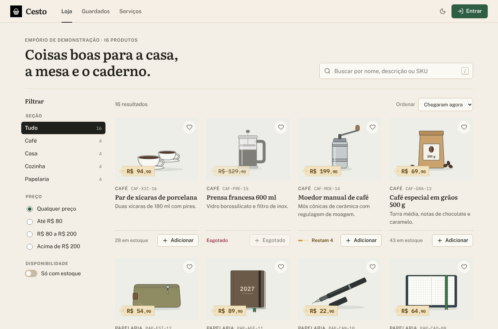
</p>

---

## Sumário

- [Visão geral](#visão-geral)
- [Novidades da versão 1.2](#novidades-da-versão-12)
- [Telas](#telas)
- [Arquitetura](#arquitetura)
- [Como rodar](#como-rodar)
- [Contas de demonstração](#contas-de-demonstração)
- [Pagamentos](#pagamentos)
- [Usando a API](#usando-a-api)
- [Configuração](#configuração)
- [Design e acessibilidade](#design-e-acessibilidade)
- [Desenvolvimento e testes](#desenvolvimento-e-testes)
- [Documentação em PDF](#documentação-em-pdf)
- [Parceria](#parceria)
- [Licença](#licença)

## Visão geral

O Cesto resolve o que toda loja virtual enfrenta quando cresce e vira vários serviços: manter os dados certos quando cada parte tem o próprio banco. Os eventos não se perdem quando algo cai, um pedido nunca fica com estoque reservado e pagamento recusado ao mesmo tempo, e tudo sobe com um comando só.

| | O que o Cesto faz |
|---|---|
| **Oito serviços** | Gateway, autenticação, catálogo, estoque, carrinho, pedidos, pagamentos e notificações, cada um com processo e banco próprios, escaláveis sozinhos. |
| **Saga do pedido** | O checkout cria o pedido, o estoque reserva os itens, o pagamento cobra e o pedido é confirmado. Se faltar estoque ou o pagamento for recusado, a reserva volta e o pedido é cancelado com o motivo. |
| **Eventos** | Redis Streams com grupos de consumidores. Um outbox transacional só publica o evento se o dado foi gravado; quem consome descarta entregas repetidas, tenta de novo quando falha e manda para a dead-letter depois de 5 tentativas. |
| **Login** | OAuth2 com Authorization Code + PKCE para a interface e Client Credentials entre serviços. JWT RS256 com JWKS, refresh token que muda a cada uso e derruba a família inteira se for reutilizado, escopos por papel. |
| **Contratos** | Cada rota é um contrato Zod. O mesmo objeto valida entrada e saída no servidor, gera o OpenAPI e monta as chamadas do cliente HTTP da interface. |
| **Erros** | Erros de negócio (`NotFound`, `Conflict`, `InsufficientStock`, `InvalidTransition`...) viram respostas HTTP padronizadas, com código estável, detalhes por campo e `requestId`. |
| **Loja** | Filtros por seção, preço e estoque, busca, produtos guardados, carrinho em forma de cupom, checkout em três etapas, acompanhamento da saga e avisos gerados pelos eventos. |
| **Administração** | Indicadores de receita e estoque, pedidos de todos os clientes com envio e entrega, produtos e estoque, exportação em CSV e uma página com a saúde de cada serviço. |
| **Operação** | Health checks, rate limit no gateway, logs estruturados com `request-id`, desligamento gracioso, migrações versionadas e Swagger em `/api/docs`. |

## Novidades da versão 1.2

A 1.2 troca a linguagem do projeto e redesenha a loja. Nenhuma tabela, rota da API ou evento mudou: basta atualizar e reconstruir as imagens.

- **Todo o código agora é JavaScript.** Os oito serviços, os três pacotes e a interface deixaram o TypeScript. Os serviços rodam direto de `src/` com `node`, sem etapa de compilação, e os contratos continuam em Zod, com JSDoc nos pontos de entrada. O mínimo passa a ser Node.js 22.18, porque o cliente Prisma gerado é carregado direto pelo Node.
- **Identidade de empório.** Papel cru, tinta quase preta, **verde-folha** (`#2E5E43`) como única cor de ação e **palha** (`#C99A3E`) nas etiquetas de preço, com tema claro e escuro.
- **Três vozes tipográficas.** As mesmas do Lume e do Prelo: Literata nos títulos e nomes de produto, Public Sans no texto e **IBM Plex Mono** só para identificadores (SKU, número do pedido, nome do serviço, porta). As três são auto-hospedadas.
- **Loja:** filtros laterais por seção, faixa de preço e "só com estoque", com os filtros ativos em etiquetas removíveis; busca com o atalho <kbd>/</kbd>; aviso de "restam N" quando o estoque está acabando; visualização rápida do produto com quantidade.
- **Guardados:** o coração em cada produto guarda para depois. A lista fica no navegador, separada por conta, e tem "pôr tudo no carrinho".
- **Carrinho e checkout:** carrinho em forma de cupom, "guardar" tira o item do carrinho sem perdê-lo, checkout em três etapas (Entrega, Pagamento, Revisão) que lembra o último endereço.
- **Pedidos:** a saga aparece numa trilha com o serviço que resolveu cada etapa (`orders`, `inventory`, `payments`) e o motivo quando o pedido cai; "comprar de novo" devolve os itens ao carrinho.
- **Administração** com receita confirmada, ticket médio, pedidos para enviar e estoque baixo no topo, filtros de pedido, exportação em CSV, busca e filtro de estoque baixo nos produtos.
- **Serviços:** página pública que lê `/health` do gateway a cada 5 segundos e mostra cada serviço, o Redis e o tempo de resposta.
- **Documentação.** Manual técnico e documento do banco reescritos e diagramados de novo, agora com a fonte em HTML no repositório (`docs/fonte/`) para serem regenerados a cada versão.

## Telas

| | |
|---|---|
| 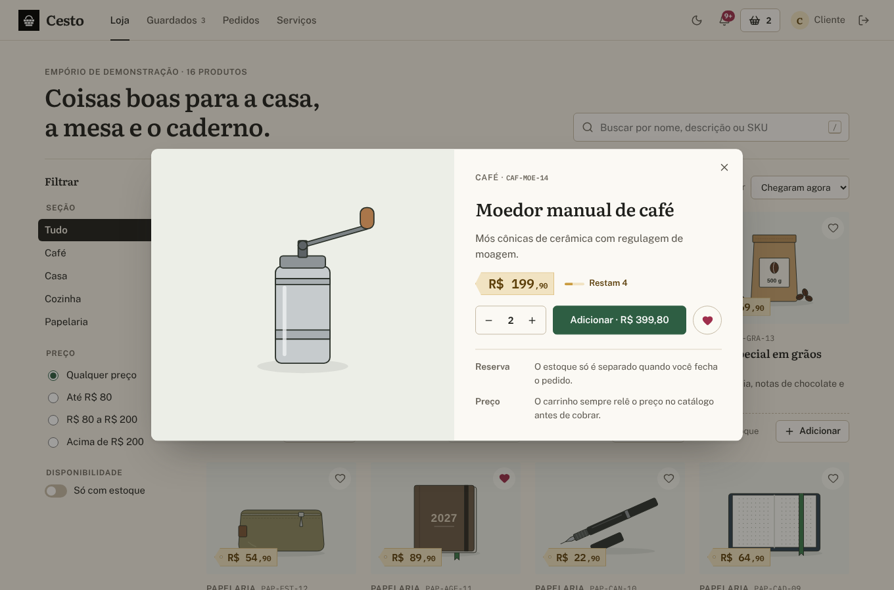 | 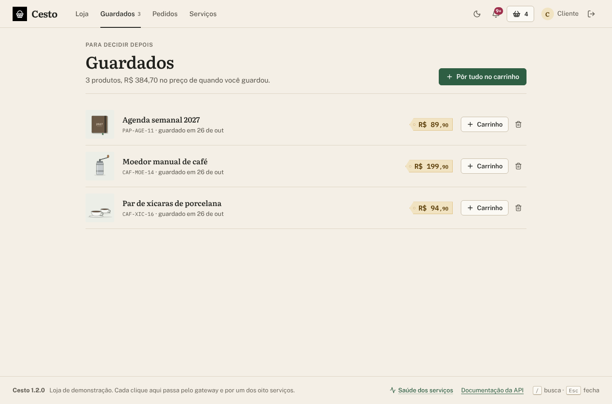 |
| **Produto** — visualização rápida com estoque, quantidade e guardar. | **Guardados** — o que ficou para depois, com "pôr tudo no carrinho". |
| 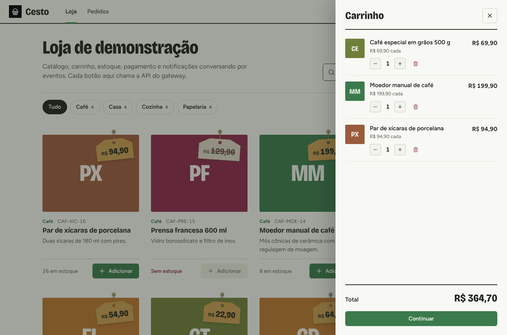 | 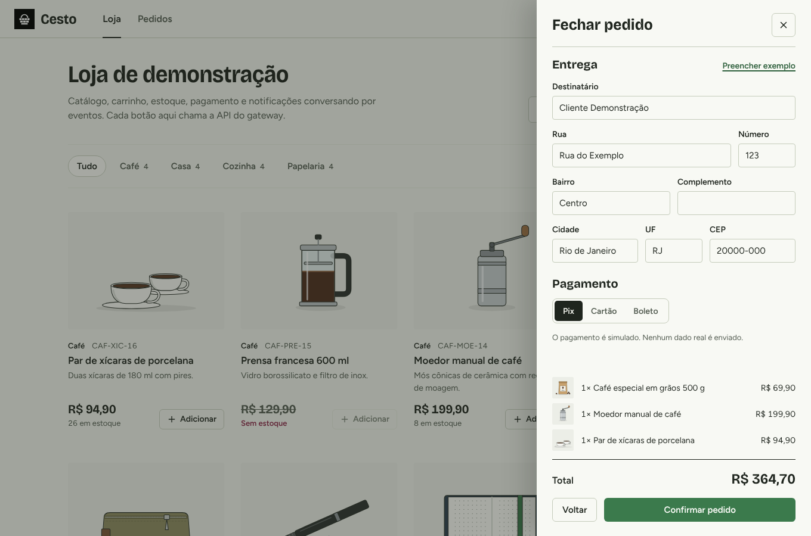 |
| **Carrinho** — cupom com quantidade, guardar e remover. | **Checkout** — Entrega, Pagamento e Revisão, lembrando o último endereço. |
| 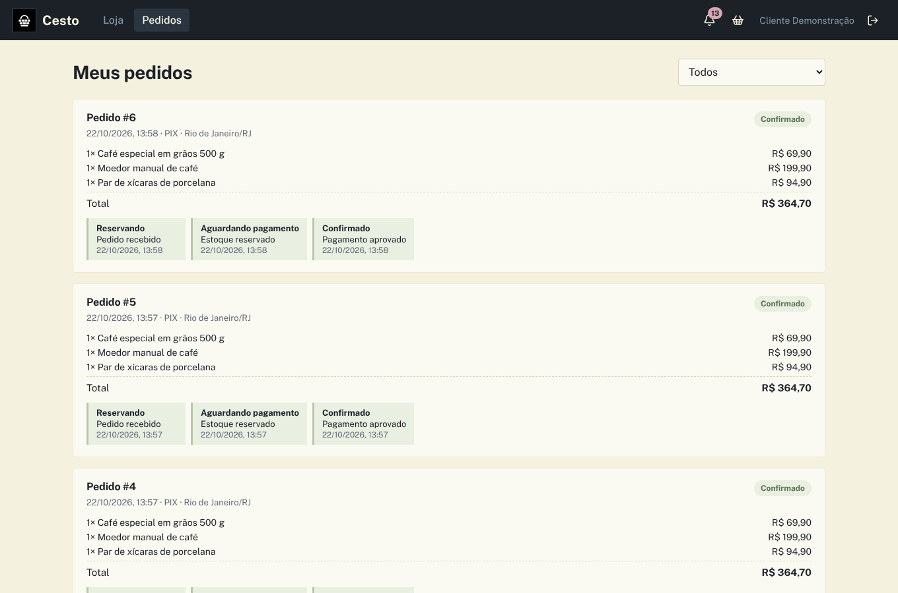 | 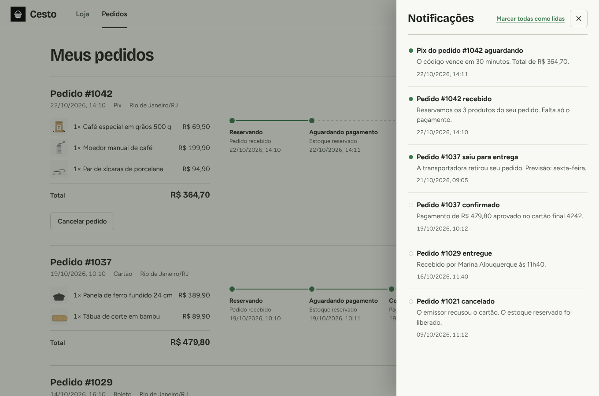 |
| **Pedidos** — a saga etapa por etapa, com o serviço de cada uma. | **Avisos** — cada evento do pedido vira uma notificação. |
| 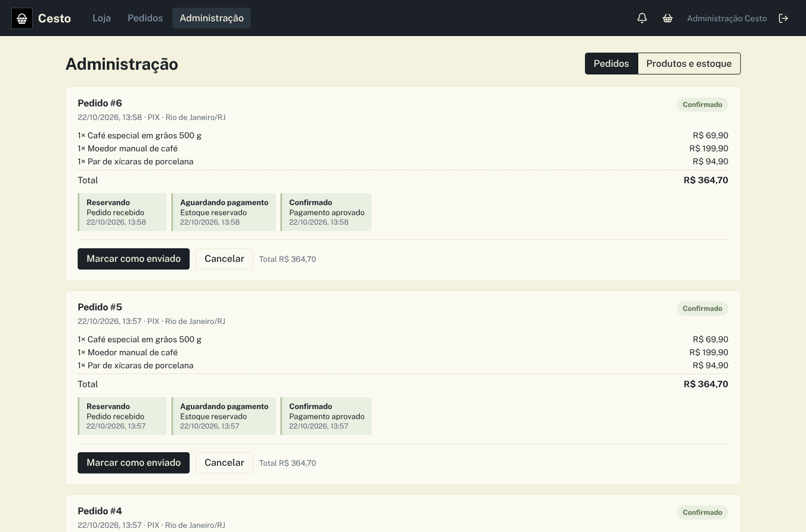 | 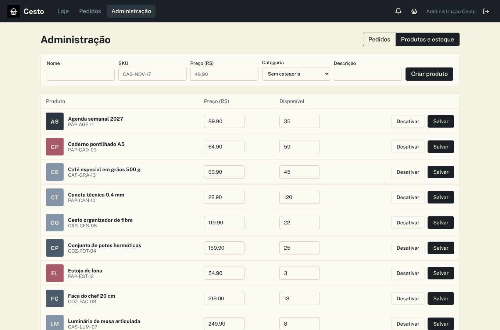 |
| **Administração** — indicadores, filtros, envio e exportação em CSV. | **Produtos e estoque** — busca, estoque baixo, preço e cadastro. |
| 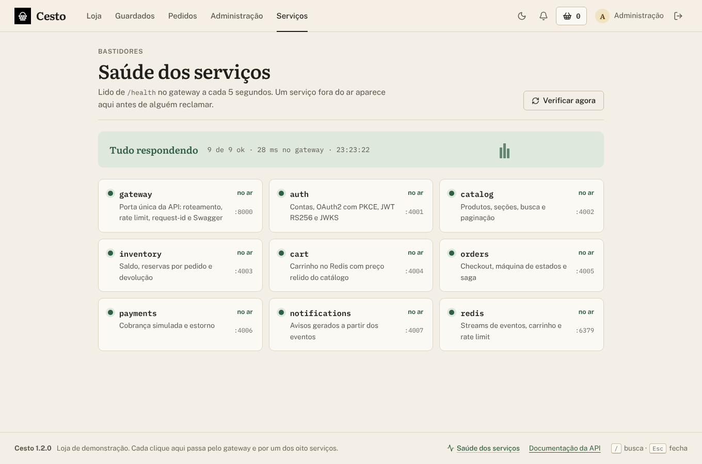 | 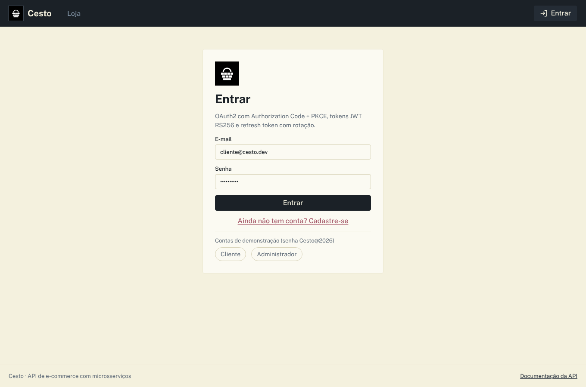 |
| **Serviços** — saúde dos oito serviços e do Redis, ao vivo. | **Entrada** — contas de demonstração e o que o PKCE faz. |
| 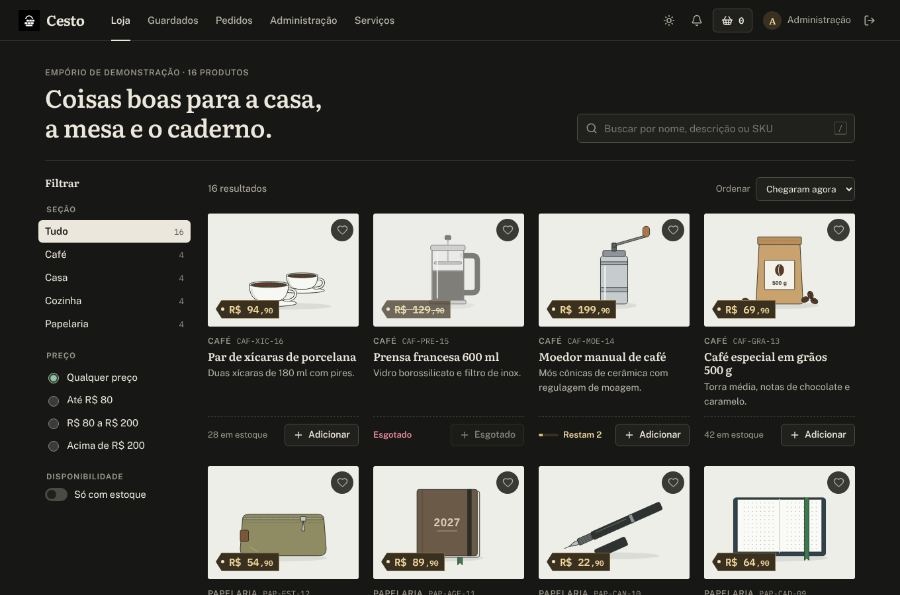 |  |
| **Tema escuro** — a mesma loja, com verde e palha mais claros. | **Tema claro** — papel cru e etiquetas de empório. |

## Arquitetura


| Serviço | Linguagem | Responsabilidade |
|---|---|---|
| `web` | JavaScript (React 19, Vite) + nginx | Loja, guardados, checkout, pedidos, avisos, administração e saúde dos serviços. O nginx entrega a interface na porta 8080 e repassa `/api`, `/oauth` e `/health` |
| `gateway` | JavaScript (Fastify 5) | Porta única da API (8000): roteamento, rate limit no Redis, `request-id`, OpenAPI e Swagger. Rotas `/internal` nunca saem daqui |
| `auth` | JavaScript (Fastify 5, Prisma 7, jose) | Usuários, clientes OAuth2, códigos de autorização, tokens, chaves de assinatura e JWKS |
| `catalog` | JavaScript (Fastify 5, Prisma 7) | Produtos, seções, busca, filtros de preço, paginação e eventos de produto |
| `inventory` | JavaScript (Fastify 5, Prisma 7) | Saldo, reservas por pedido, baixa e devolução de estoque |
| `cart` | JavaScript (Fastify 5, ioredis) | Carrinho no Redis com o preço sempre relido do catálogo |
| `orders` | JavaScript (Fastify 5, Prisma 7) | Checkout, máquina de estados e orquestração da saga |
| `payments` | JavaScript (Fastify 5, Prisma 7) | Cobrança por um gateway plugável (simulado por padrão) e estorno |
| `notifications` | JavaScript (Fastify 5, Prisma 7) | Avisos gerados a partir dos eventos |
| banco | — | Fonte da verdade, com um banco por serviço no PostgreSQL 16: `cesto_auth`, `cesto_catalog`, `cesto_inventory`, `cesto_orders`, `cesto_payments` e `cesto_notifications` |
| `redis` | — | Streams de eventos, carrinhos, rate limit do gateway e dead-letter |

### Como um pedido é processado

1. `POST /api/v1/orders` lê o carrinho e os preços atuais com um token de serviço, grava o pedido como Reservando e, na mesma transação, o evento `order.placed` no outbox.
2. O `inventory` reserva todos os itens de uma vez (`available >= quantidade`, numa transação). Se algum faltar, publica `inventory.rejected` e o pedido é cancelado.
3. Com a reserva feita, o pedido passa a Aguardando pagamento e publica `payment.requested`. O `payments` cobra e responde `payment.approved` ou `payment.declined`.
4. Se o pagamento for aprovado, o pedido fica Confirmado e a reserva vira baixa definitiva. Se for recusado, o pedido é cancelado e a reserva volta para o saldo.
5. O evento `order.placed` esvazia o carrinho, e cada etapa vira um aviso para o cliente. Depois a loja marca o pedido como Enviado e Entregue.

O modelo de dados completo — diagrama de cada banco, todas as tabelas com campos, tipos, chaves e índices, máquinas de estado, outbox e chaves do Redis — está em [`Banco-de-Dados-Cesto.pdf`](Banco-de-Dados-Cesto.pdf).

### Contratos e validação

Os contratos ficam em [`packages/contracts`](packages/contracts) e são a única fonte da verdade:

```js
export const api = {
  orders: {
    checkout: defineEndpoint({
      method: 'POST',
      path: '/api/v1/orders',
      auth: 'user',
      scopes: ['orders:write'],
      body: CheckoutBody,
      response: OrderDto,
      status: 202
    })
  }
};

route(app, api.orders.checkout, ({ principal, body }) => orders.checkout(principal.id, body));

const order = await request(api.orders.checkout, { body: { shippingAddress, paymentMethod: 'pix' } });
```

| Peça | O que entrega |
|---|---|
| `defineEndpoint` | Método, caminho, autenticação, escopos e esquemas Zod de params, query, body e resposta num só objeto |
| `paginated(schema)`, `toPage`, envelope `{ ok, data }` | DTOs de página e de resposta usados por todos os serviços |
| `route(app, endpoint, handler)` | Valida params, query e body com Zod, checa token, papel e escopos e valida a saída antes de responder |
| `callEndpoint` / `ServiceClient` | Cliente HTTP que monta a URL a partir do contrato, com token de serviço em cache para chamadas internas |
| `DomainError` e subclasses | Erros de negócio com código estável e status HTTP definido num só lugar |
| `eventSchemas` | Cada evento tem esquema próprio, validado ao publicar e ao consumir |
| JSDoc (`@typedef`, `@template`) | Descreve os pontos de entrada para o editor completar e checar quem quiser usar `// @ts-check` |

### Segurança

| Regra | Como funciona |
|---|---|
| Senhas | scrypt com sal aleatório, comparadas em tempo constante |
| Login da interface | Authorization Code + PKCE (S256): o navegador manda só o hash do verifier, e o código vale uma vez |
| Tokens | JWT RS256 de 15 minutos, com `kid` e chaves públicas em `/oauth/jwks`. O refresh token vale 30 dias, é guardado só como hash e muda a cada uso |
| Reuso | Um refresh token usado duas vezes revoga a família inteira de tokens daquela sessão |
| Escopos | Cliente: `orders:read`, `orders:write`, `cart:write`, `notifications:read`. Administração ganha `catalog:write`, `inventory:write` e `orders:manage` |
| Entre serviços | Client Credentials com segredo próprio; rotas `/internal` respondem 404 pelo gateway |
| Limite | Rate limit por IP no gateway (300 por minuto por padrão), guardado no Redis |
| Entrada | Validação estrita com Zod em params, query e body; campos desconhecidos são recusados |

## Como rodar

Você só precisa do **Docker** com Docker Compose.

**Windows:** dê dois cliques em `iniciar.cmd`.

**Linux ou macOS:**

```bash
./iniciar.sh
```

Na primeira vez o script cria o arquivo `.env` com uma senha aleatória para o banco e um segredo aleatório para os serviços, sobe os contêineres (PostgreSQL, Redis, os oito serviços e a interface) e abre **http://localhost:8080**.

| Endereço | O que é |
|---|---|
| http://localhost:8080 | Loja e administração |
| http://localhost:8080/api/docs | Documentação da API (Swagger) |
| http://localhost:8080/api/openapi.json | Especificação OpenAPI gerada dos contratos |
| http://localhost:8080/health | Saúde do gateway, do Redis e de cada serviço |

Para rodar sem o script:

```bash
cp .env.example .env              # troque DB_PASSWORD e SERVICE_CLIENT_SECRET
docker compose up -d --build
docker compose logs -f orders     # acompanhar a saga
```

| Para | Comando |
|---|---|
| Parar (os dados ficam nos volumes) | `docker compose down` |
| Atualizar depois de baixar uma versão nova | `docker compose up -d --build` |
| Mais consumidores de eventos | `docker compose up -d --scale inventory=3 --scale payments=2` |
| Abrir o terminal do banco | `docker compose exec postgres psql -U cesto -d cesto_orders` |
| Abrir o terminal do Redis | `docker compose exec redis redis-cli` |
| Apagar tudo, inclusive os dados | `docker compose down -v` |

> Atualizando da 1.1? Rode `docker compose up -d --build`. Os bancos e os eventos não mudaram; as imagens passam a rodar o código em JavaScript e a interface nova.

## Contas de demonstração

As duas usam a senha **`Cesto@2026`**. Elas existem só para testes, para qualquer pessoa entrar logo depois de baixar o projeto. Nomes, produtos, endereços e o domínio `cesto.dev` são fictícios.

| Papel | E-mail | O que pode fazer |
|---|---|---|
| Cliente | `cliente@cesto.dev` | Guardar produtos, comprar, acompanhar pedidos e receber avisos |
| Administração | `admin@cesto.dev` | Tudo, incluindo produtos, estoque, expedição e exportação em CSV |

Na tela de entrada, um clique numa das contas preenche e-mail e senha.

Para usar de verdade:

1. Suba com `SEED_DEMO=false` num banco vazio. Os clientes OAuth2 continuam sendo criados.
2. Ajuste `WEB_REDIRECT_URIS` e `CORS_ORIGINS` para o endereço público e coloque um proxy com HTTPS na frente da porta `APP_PORT`.
3. Crie a sua conta pela tela **Criar conta** e promova-a a administração direto no banco `cesto_auth`:

   ```sql
   UPDATE users SET role = 'ADMIN' WHERE email = 'voce@sualoja.com.br';
   ```

4. Saia e entre de novo para os novos escopos valerem no token.

O manual traz o checklist completo para produção (HTTPS, segredos, Swagger e backup).

## Pagamentos

O projeto vem com um gateway simulado: nada sai da aplicação e nenhum dado de cartão é enviado. Ele existe para mostrar a saga confirmando e desfazendo pedidos.

| Forma | Como testar | Observação |
|---|---|---|
| Pix | Escolha Pix no checkout | Aprovado. O pedido vai a Confirmado em cerca de um segundo |
| Boleto | Escolha Boleto no checkout | Aprovado na simulação |
| Cartão | Escolha Cartão no checkout | Aprovado |
| Cartão | Ligue **Simular cartão recusado** | Recusado pelo emissor: o pedido é cancelado e a reserva de estoque volta |
| Qualquer | Pedido acima de `PAYMENT_DECLINE_ABOVE_CENTS` (padrão R$ 5.000,00) | Recusado por limite de valor |
| Qualquer | Compre a Prensa francesa 600 ml, que começa zerada | Cancelado antes do pagamento, por falta de estoque |

Nos casos de falha, o pedido aparece cancelado com o motivo e a trilha da saga marca a etapa que caiu. Para um provedor real, escreva uma classe com o método `charge` descrito no `@typedef PaymentGateway` de [`services/payments/src/gateway.js`](services/payments/src/gateway.js), troque o `SimulatedGateway` no `main.js` e reconstrua o serviço:

```bash
docker compose up -d --build payments
```

O tempo da cobrança simulada e o limite de valor ficam no `.env` (`PAYMENT_DELAY_MS` e `PAYMENT_DECLINE_ABOVE_CENTS`).

## Usando a API

O login da interface usa Authorization Code com PKCE. Scripts fazem o mesmo fluxo; o [`scripts/smoke.mjs`](scripts/smoke.mjs) é um exemplo completo. Envie o token no cabeçalho `Authorization: Bearer <token>`.

```bash
# catálogo público, com busca e faixa de preço em centavos
curl "http://localhost:8080/api/v1/catalog/products?q=café&minPrice=5000&maxPrice=20000&sort=price_asc"

# carrinho
curl -H "Authorization: Bearer $TOKEN" -H "Content-Type: application/json" \
     -d '{"productId":"<id>","quantity":2}' http://localhost:8080/api/v1/cart/items

# fechar o pedido
curl -H "Authorization: Bearer $TOKEN" -H "Content-Type: application/json" \
     -d '{"paymentMethod":"pix","shippingAddress":{"recipient":"Ana","street":"Rua A","number":"10","district":"Centro","city":"Niterói","state":"RJ","postalCode":"24020-000"}}' \
     http://localhost:8080/api/v1/orders
```

| Rota | O que faz |
|---|---|
| `POST /oauth/authorize` · `/oauth/token` · `/oauth/revoke` · `GET /oauth/jwks` | Login com PKCE, emissão e revogação de tokens, chaves públicas |
| `POST /api/v1/auth/register` · `GET /api/v1/auth/me` | Cadastro e usuário atual |
| `GET /api/v1/catalog/products` · `.../{id}` | Busca (`q`), seção (`category`), faixa de preço (`minPrice`, `maxPrice`), ordenação (`sort`) e paginação |
| `POST/PATCH/DELETE /api/v1/catalog/products` · `POST /api/v1/catalog/categories` | Gestão do catálogo (`catalog:write`) |
| `GET /api/v1/inventory` · `PUT /api/v1/inventory/{id}` | Saldo por produto e ajuste (`inventory:write`) |
| `GET/DELETE /api/v1/cart` · `POST /api/v1/cart/items` · `PATCH .../{productId}` | Carrinho |
| `POST /api/v1/orders` · `GET /api/v1/orders` · `GET .../{id}` · `POST .../{id}/cancel` | Checkout, histórico e cancelamento |
| `PATCH /api/v1/orders/{id}/status` | Envio, entrega ou cancelamento pela loja (`orders:manage`) |
| `GET /api/v1/payments/orders/{orderId}` | Pagamentos e estornos do pedido |
| `GET /api/v1/notifications` · `/unread` · `POST .../{id}/read` · `/read-all` | Avisos |

Toda resposta segue o mesmo envelope, com um `code` estável nos erros (por exemplo `INSUFFICIENT_STOCK` ou `INVALID_STATE_TRANSITION`):

```json
{ "ok": true, "data": { "id": "...", "status": "PENDING" } }
{ "ok": false, "error": { "code": "INSUFFICIENT_STOCK", "message": "...", "details": {}, "requestId": "..." } }
```

A referência completa, com esquemas de entrada e saída, fica em `/api/docs` (Swagger) e no capítulo de API do manual.

## Configuração

As principais variáveis do `.env` (a lista completa está no manual):

| Variável | Padrão | O que faz |
|---|---|---|
| `APP_PORT` / `GATEWAY_PORT` | `8080` / `8000` | Portas da interface e da API |
| `DB_USER` / `DB_PASSWORD` | `cesto` / — | PostgreSQL. A senha é gerada pelos scripts; nunca publique a sua |
| `SERVICE_CLIENT_SECRET` | — | Segredo do cliente OAuth2 usado entre serviços. Gerado pelos scripts |
| `ACCESS_TOKEN_TTL` / `REFRESH_TOKEN_TTL` | `900` / `2592000` | Validade dos tokens em segundos |
| `WEB_REDIRECT_URIS` | `http://localhost:8080/callback` | Endereços permitidos para o login da interface |
| `CORS_ORIGINS` | `http://localhost:8080` | Origens aceitas pelos serviços |
| `SEED_DEMO` | `true` | Contas, seções, produtos e estoque de demonstração |
| `PAYMENT_DECLINE_ABOVE_CENTS` / `PAYMENT_DELAY_MS` | `500000` / `800` | Comportamento do pagamento simulado |
| `RATE_LIMIT_MAX` / `RATE_LIMIT_WINDOW` | `300` / `1 minute` | Limite de requisições por IP no gateway |
| `LOG_LEVEL` | `info` | Nível dos logs |

## Design e acessibilidade

A interface não usa framework de CSS: tudo sai de tokens no topo de `apps/web/src/styles.css`, com tema claro e escuro trocados por `data-theme`. A paleta é a de um empório de bairro: papel cru, verde-folha e etiquetas de palha.

| Papel | Claro | Escuro | Uso |
|---|---|---|---|
| Papel | `#F4EFE6` Papel cru | `#171815` | Fundo das páginas |
| Superfície | `#FBF9F4` | `#20211D` | Cartões, painéis e janelas |
| Tinta | `#1F201C` Tinta | `#ECE7DC` | Texto e títulos |
| Assinatura | `#2E5E43` Folha | `#8FC3A2` | Botões, links, foco e etapas concluídas da saga |
| Destaque | `#C99A3E` Palha | `#E2BC6A` | Etiquetas de preço, filtros ativos e estoque acabando |
| Estados | `#2E5E43` · `#9E2F4C` Beterraba | `#8FC3A2` · `#E8899F` | Pedido confirmado e em estoque · esgotado, pagamento recusado e cancelamentos |

**Tipografia:** Literata (títulos e nomes de produto) · Public Sans (interface) · IBM Plex Mono (SKU, número do pedido, serviço, porta e valores do cupom). As três são auto-hospedadas em `apps/web/public/fonts`, sem chamadas a serviços externos.

**Acessibilidade:** link "Pular para o conteúdo", foco visível em todos os controles, contraste AA nos dois temas, rótulos ARIA nas ações só com ícone, avisos e contagens lidos por leitores de tela (`aria-live`), etapas do checkout marcadas com `aria-current`, `Esc` fechando painéis e janelas, voltar e avançar do navegador trocando de seção, e animações desligadas com `prefers-reduced-motion`.

**Atalhos de teclado**

| Onde | Tecla | Ação |
|---|---|---|
| Loja | <kbd>/</kbd> | Buscar produtos |
| Painéis e janelas | <kbd>Esc</kbd> | Fechar o carrinho, os avisos ou a visualização do produto |

<p align="center">
  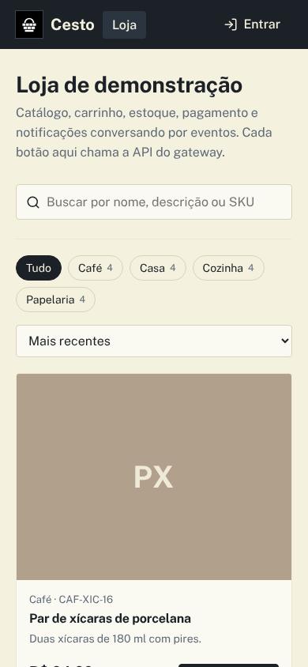
</p>

## Desenvolvimento e testes

Sem Docker, com Node.js 22.18 ou mais novo, PostgreSQL 16 e Redis 7:

```bash
npm ci
cp .env.example .env                 # ajuste DB_USER, DB_PASSWORD e DB_HOST
psql -U postgres -f docker/postgres/init.sql
npm run generate                     # clientes Prisma de cada serviço
npm run migrate                      # aplica as migrações nos seis bancos
npm run dev                          # sobe os oito serviços com node --watch (sem compilar nada)
npm run dev -w apps/web              # interface em http://localhost:5173
```

```bash
npm test                                         # Vitest: pacotes, serviços e interface
TEST_REDIS_URL=redis://localhost:6379 npm test   # inclui o barramento com Redis real
npm run check                                    # node --check em todos os arquivos JavaScript
API_URL=http://localhost:8000 npm run smoke      # 21 verificações ponta a ponta na API rodando
```

São 46 testes em 11 arquivos (contratos e esquemas, rotas validadas, erros de domínio, outbox, barramento com novas tentativas e dead-letter, OAuth2 e PKCE, carrinho, saga, modelos de aviso e formatação da interface) e 21 verificações ponta a ponta (login com PKCE, saga confirmada, pagamento recusado e falta de estoque desfazendo a reserva, rotação e reuso de refresh token, permissões, transição inválida, avisos e rotas internas fora do gateway). O GitHub Actions gera os clientes Prisma, monta a interface, verifica a sintaxe, roda os testes, aplica as migrações, sobe os serviços, executa o teste ponta a ponta e constrói as imagens Docker a cada push.

### Estrutura

```text
packages/contracts/   esquemas Zod, DTOs, contratos das rotas, eventos e cliente HTTP
packages/core/        servidor Fastify, rotas validadas, OAuth2 (verificação), erros de domínio, outbox, OpenAPI
packages/bus/         barramento de eventos em Redis Streams com novas tentativas e dead-letter
services/             gateway, auth, catalog, inventory, cart, orders, payments, notifications (rodam de src/)
  */prisma/           esquema e migrações de cada banco
apps/web/             loja e administração em React + Vite (JSX)
  src/pages/          loja, guardados, pedidos, administração, serviços e entrada
  src/components/     carrinho e checkout, visualização do produto, avisos, etiquetas e trilha da saga
  public/fonts/       Literata, Public Sans e IBM Plex Mono (OFL)
docker/               Dockerfiles, nginx e criação dos bancos
scripts/              desenvolvimento local, migrações, geração do Prisma, verificação e teste ponta a ponta
docs/                 manuais em PDF, imagens do README e fonte dos manuais (docs/fonte)
.github/workflows/    CI e atividade diária
```

### Como contribuir

1. Abra uma issue descrevendo a ideia ou o problema.
2. Crie uma branch a partir da `main` e envie um pull request.
3. Nova rota: declare o contrato em `packages/contracts/src/api.js` e registre com `route(app, api.x.y, handler)` no serviço. Validação, autorização, OpenAPI e o cliente HTTP vêm juntos.
4. Novo evento: acrescente o esquema em `eventSchemas`, grave no outbox de quem publica e inscreva o handler com `bus.subscribe` em quem consome.
5. Novo serviço: copie um serviço existente, crie o banco em `docker/postgres/init.sql`, adicione o bloco no `docker-compose.yml` e o prefixo em `services/gateway/src/routes.js`.
6. Mudou algo visível? Atualize as capturas em `docs/images` e regenere os PDFs.
7. Quando a mudança for feita em dupla, inclua a linha `Co-authored-by:` no commit para que as duas pessoas recebam o crédito.

## Documentação em PDF

| Documento | Conteúdo |
|---|---|
| [`Manual-Cesto.pdf`](Manual-Cesto.pdf) | Instalação, cada tela da loja e da administração, arquitetura, saga, OAuth2, contratos Zod, API, configuração, como estender o projeto, testes e solução de problemas |
| [`Banco-de-Dados-Cesto.pdf`](Banco-de-Dados-Cesto.pdf) | Diagrama de cada banco, todas as tabelas com campos, tipos, chaves e índices, máquinas de estado, outbox, chaves do Redis e como preparar o PostgreSQL |

Cópias idênticas ficam em [`docs/`](docs). Os dois são gerados a partir de HTML e CSS em [`docs/fonte`](docs/fonte), na mesma identidade da interface, com o Chromium do Playwright:

```bash
npm i --no-save playwright && npx playwright install chromium
node docs/fonte/gerar_pdfs.mjs
```

## Parceria

Projeto desenvolvido em parceria com meu parceiro de projetos e de vida Erik Pimenta (@ravelroot).

O repositório oficial fica em [Violet-pixel/E-commerce-Microservices-API](https://github.com/Violet-pixel/E-commerce-Microservices-API).

### Componentes de terceiros

O Cesto inclui ou depende de componentes com licenças próprias, que continuam valendo para cada um deles:

| Componente | Uso no projeto | Licença |
|---|---|---|
| [Fastify](https://fastify.dev/) | Servidor HTTP dos serviços e proxy do gateway | MIT |
| [Prisma](https://www.prisma.io/) | ORM, migrações e cliente de banco | Apache-2.0 |
| [Zod](https://zod.dev/) | Validação de entrada, saída e eventos | MIT |
| [jose](https://github.com/panva/jose) | Assinatura e verificação de JWT e JWKS | MIT |
| [ioredis](https://github.com/redis/ioredis) | Cliente Redis para Streams, carrinho e rate limit | MIT |
| [React](https://react.dev/) | Interface | MIT |
| [Vite](https://vite.dev/) e [Vitest](https://vitest.dev/) | Build da interface e testes | MIT |
| [Lucide](https://lucide.dev/) | Ícones da interface | ISC |
| [Swagger UI](https://github.com/swagger-api/swagger-ui) | Página de documentação da API | Apache-2.0 |
| [Literata](https://github.com/googlefonts/literata) | Fonte dos títulos e nomes de produto | SIL Open Font License 1.1 |
| [Public Sans](https://github.com/uswds/public-sans) | Fonte da interface | SIL Open Font License 1.1 |
| [IBM Plex Mono](https://github.com/IBM/plex) | Identificadores e trechos de código | SIL Open Font License 1.1 |
| [Playwright](https://playwright.dev/) | Geração dos manuais em PDF (só no desenvolvimento) | Apache-2.0 |

PostgreSQL, Redis e nginx rodam como serviços externos via Docker e não são redistribuídos neste repositório; cada um segue a licença da sua própria imagem.

Os produtos, clientes, endereços e pedidos de demonstração são fictícios.

## Licença

Copyright (©) 2026 Clara Portes

Este projeto é distribuído sob a licença [MIT](LICENSE). Você pode usar, copiar, modificar e redistribuir o código, inclusive para fins comerciais, desde que mantenha o aviso de copyright e o texto da licença.
